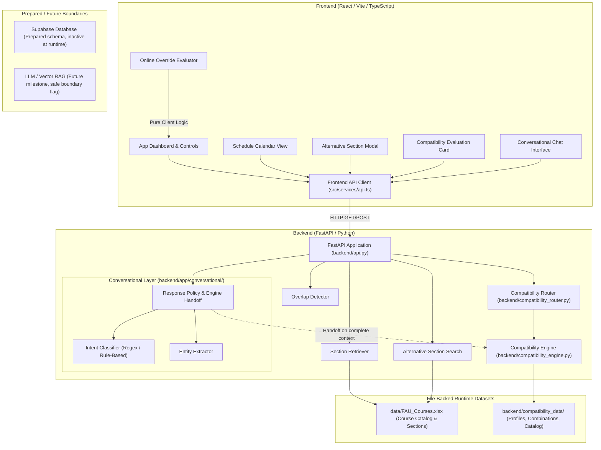

# SmartAdvisor Architecture & System Design

SmartAdvisor is an academic planning and advising decision-support system designed for undergraduate engineering and computer science students.

> [!NOTE]
> **Advising Scope & Authority Boundary:**
> SmartAdvisor is an educational prototype and decision-support assistant. It does **not** replace academic advisors, cannot officially approve course overrides, and cannot register students for courses. Official degree requirements and approvals must go through university advisors and registrar workflows.

---

## High-Level Architecture

---

## Component Breakdown

### 1. Frontend Web Application (`frontend/`)
- **Technology:** React 19, TypeScript, Vite.
- **Entry Points:** `frontend/src/main.tsx` and `frontend/src/App.tsx`.
- **Core Modules:**
  - **Schedule Calendar (`src/components/ScheduleCalendar.tsx`):** Renders selected course sections into weekly calendar grid slots. Computes layout, start/end times, and highlights conflicting blocks.
  - **Online Override Evaluator (`src/components/OnlineOverrideEvaluator.tsx`):** Interactive questionnaire screening students against prerequisite and policy criteria. Evaluates pure client-side rules without backend persistence.
  - **Conversational Assistant UI:** Embedded chat panel enabling natural language queries, demonstrating deterministic intent extraction, clarification prompting, advisor escalation, and direct compatibility engine execution.
  - **API Client (`src/services/api.ts`):** Centralized HTTP service communicating with the FastAPI backend via `fetch` requests with configurable base URL (`VITE_API_URL`).

### 2. Backend Services (`backend/`)
- **Technology:** FastAPI, Uvicorn, Python 3.11+.
- **Entry Point:** `backend/api.py`.
- **Core Modules:**
  - **Section Retriever (`backend/section_retriever.py`):** Ingests and caches `data/FAU_Courses.xlsx`. Serves course listings and filtered section details by department, course number, CRN, or term.
  - **Overlap Detector (`backend/overlap_detector.py`):** Compares day of week and start/end time intervals to detect scheduling overlaps between multiple sections.
  - **Alternative Section Search (`backend/alternative_section_search.py`):** Finds candidate open/alternative sections for a conflicting CRN that do not conflict with the student's existing schedule.
  - **Course Compatibility Engine (`backend/compatibility_engine.py`):** Evaluates academic workload intensity, credit bounds, recent semester difficulty, and course combination risks using synthetic profiles.
  - **Conversational Layer (`backend/app/conversational/`):**
    - `intent_classifier.py`: Deterministic classifier identifying 6 canonical intents (`course_compatibility_check`, `alternative_section_search`, `general_schedule_advice`, `override_inquiry`, `advisor_escalation`, `unsupported_query`).
    - `entity_extractor.py`: Extracts course codes, section CRNs, schedule constraints, and modality preferences via regex patterns.
    - `response_policy.py`: Manages routing decisions, enforces required context verification, handles advisor escalation, and flags future RAG candidate queries.

---

## Data Architecture & Runtime State

### 1. File-Backed Runtime
SmartAdvisor currently operates in a **file-backed** architecture:
- `data/FAU_Courses.xlsx`: The active source for course catalog search, section retrieval, and meeting time parsing.
- `backend/compatibility_data/`: Contains `Course Combinations.xlsx`, `Final_FAU_CS_CE_EE_Undergraduate_Courses_Revised (1) (2).xlsx`, and `Synthetic Profiles.xlsx` used strictly by the Course Compatibility Engine.

### 2. Supabase Cloud Status (Prepared / Inactive)
- Database schema definitions are prepared in `supabase/migrations/20261009_initial_schema.sql`.
- Migration and upload scripts reside in `scripts/`.
- **Runtime status:** Inactive. The backend does not connect to Supabase during normal application runtime; no cloud database credentials are required to run or test SmartAdvisor locally.

### 3. Future LLM and RAG Boundary
- Complex descriptive queries (e.g., course syllabus questions, general campus life) are categorized under `future_rag_candidate = true` and `response_code = "RAG_INACTIVE"`.
- No live generative model or vector retrieval is connected, preventing ungrounded advice and hallucinated academic policies.

### 4. Client State & Persistence
- Schedule selections, alternative swaps, and chat messages are currently maintained in **client-side React state** (`useState`).
- Refreshing the browser resets the session to the default clean state.
