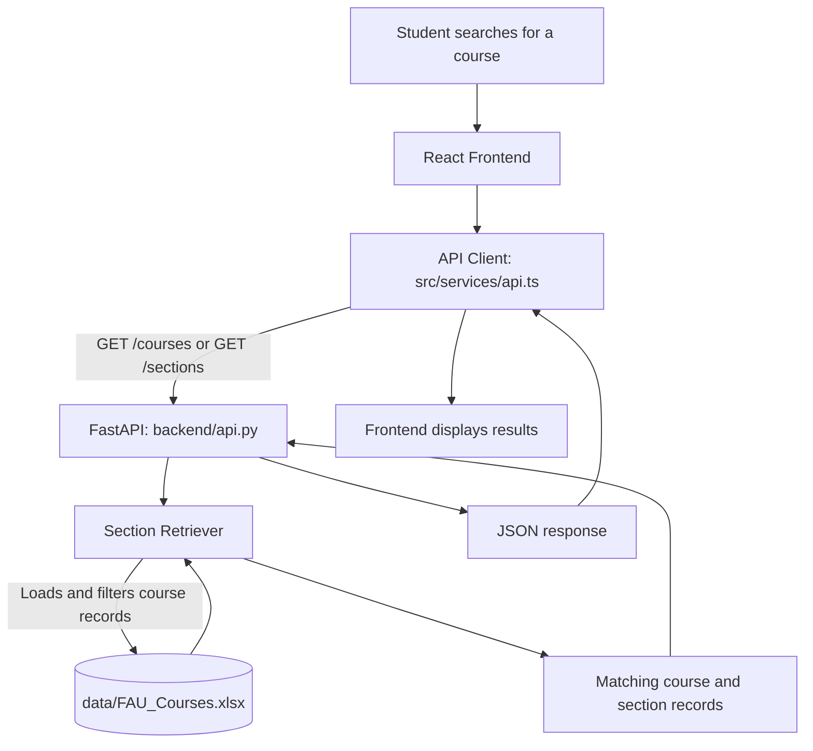
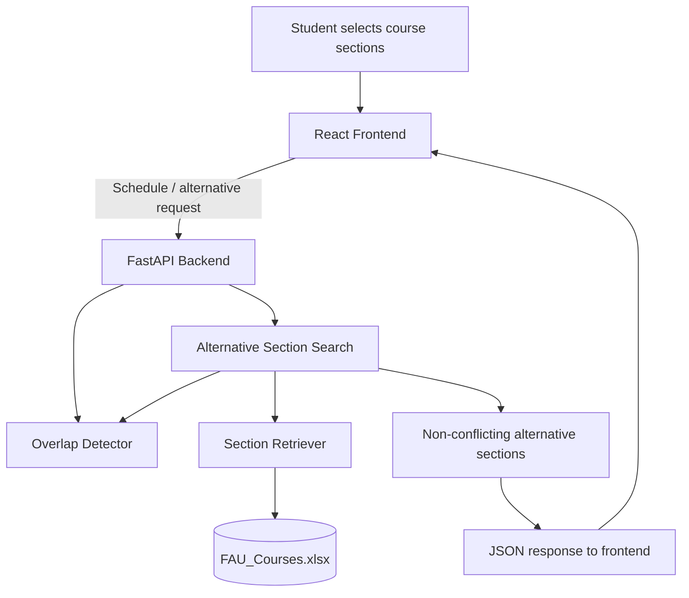

# SmartAdvisor API and Data Flow

## Course Search and Section Retrieval

## Scheduling Conflict and Alternative Section Flow

## Data-Flow Explanation

1. **Student request:** The student searches for a course or section through the React interface.
2. **Frontend API client:** The frontend sends an HTTP request to the FastAPI backend.
3. **Backend processing:** FastAPI routes the request to the appropriate backend service.
4. **Course data:** The Section Retriever loads and filters information from `data/FAU_Courses.xlsx`.
5. **Response:** FastAPI returns matching course or section information as JSON.
6. **Frontend display:** React displays the returned information to the student.

For scheduling requests, the Overlap Detector compares meeting days and times. The Alternative Section Search evaluates potential replacement sections against existing scheduling constraints.

## Current Data Architecture

- The active course-search API uses the local Excel course dataset.
- Compatibility evaluation uses separate Excel datasets.
- Supabase cloud integration is prepared but inactive for normal runtime.
- Local PostgreSQL seed/reset testing is separate from the active Excel-backed API.

## Verified Demonstration Evidence

- FastAPI successfully served `GET /courses` with HTTP 200.
- The local backend loaded 913 FAU course-section records.
- The React frontend successfully retrieved course information from the local backend.
- Local course search worked with Wi-Fi disabled.

## Sources

- `docs/architecture.md`
- `docs/api.md`
- `docs/DEMO_RELIABILITY_REPORT.md` (Task 12.1 branch / Pull Request #17)
