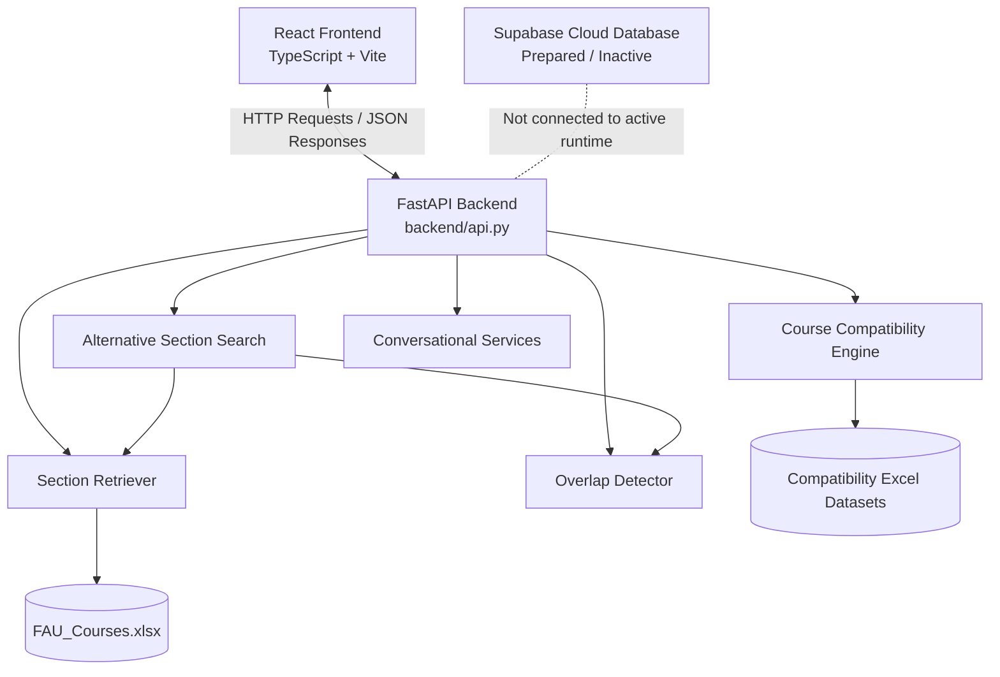

# SmartAdvisor Backend Architecture

## System Architecture Diagram

## Component Summary

- **Frontend:** React 19, TypeScript, and Vite provide course search, scheduling, and conversational interfaces.
- **API Layer:** FastAPI receives HTTP requests, validates inputs, and returns JSON responses.
- **Section Retriever:** Loads and filters FAU course-section information from Excel.
- **Overlap Detector:** Identifies scheduling conflicts using meeting days and times.
- **Alternative Section Search:** Searches for available replacement sections that avoid conflicts.
- **Course Compatibility Engine:** Evaluates student workload and course combination risks using compatibility datasets.
- **Conversational Services:** Classify student requests, extract course information, and route requests to supported backend functions.
- **Data Storage:** Excel files are the active runtime data sources. Supabase database integration is prepared but inactive.

## Architecture Notes

The currently documented application uses a file-backed backend. Schedule selections and chat history are maintained in React client-side state. The local PostgreSQL demo database used for reliability testing is separate from the active Excel-backed course API.

Source: `docs/architecture.md`
