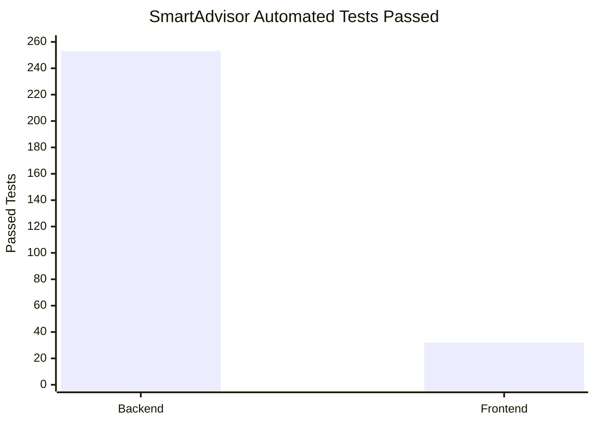

# SmartAdvisor Backend and Frontend Test Evidence

## Automated Test Results

| Test Suite | Passed | Failed | Warnings | Execution Time |
|---|---:|---:|---:|---|
| Python / pytest | 253 | 0 | 3 | 43.50 seconds |
| Frontend / Node.js | 32 | 0 | — | 337.03 ms |
| **Total** | **285** | **0** | **3 backend warnings** | — |

All 285 automated tests passed in the verified local test runs. The three Python warnings did not cause test failures.

## Test Results Chart



## Backend Test Coverage

The documented backend test suites cover:

- FastAPI endpoint responses and input handling.
- Course and section retrieval.
- Alternative section searches.
- Scheduling overlap detection.
- Meeting-time normalization.
- Course compatibility evaluation.
- Conversational intent classification and response handling.
- API integration and regression behavior.

Command executed from the repository root:

```powershell
python -m pytest -q
```

Verified result:

```text
253 passed, 3 warnings in 43.50s
```

## Frontend Test Coverage

The documented frontend tests cover:

- Online override evaluation logic.
- Scheduling and course-section transformation utilities.
- Frontend/backend request and response handling.
- Conversational client behavior.

Command executed from the frontend directory:

```powershell
npm.cmd test
```

Verified result:

```text
tests 32
suites 11
pass 32
fail 0
cancelled 0
skipped 0
duration_ms 337.0335
```

## Frontend Production Build

Command executed from the frontend directory:

```powershell
npm.cmd run build
```

Verified result:

```text
tsc -b && vite build
22 modules transformed
built in 533ms
```

The React frontend completed TypeScript compilation and a Vite production build.

## Demo Reliability Evidence

The following checks were documented during Task 12.1:

| Reliability Check | Verified Result |
|---|---|
| Local PostgreSQL demo seed/reset | Three successful consecutive cycles |
| Original unrelated test record | Preserved across all three cycles |
| PostgreSQL backup | Created successfully |
| Backup restoration | Successfully verified in a separate test database |
| FastAPI startup | Successful using fallback port 8002 |
| GET /courses | HTTP 200; 913 FAU course-section records |
| Frontend/backend integration | React successfully retrieved local course data |
| Offline fallback | Local course search worked with Wi-Fi disabled |

### Scope and Limitations

- The three seed/reset cycles are database checks, not three complete end-to-end application demonstrations.
- Offline verification covered local course search, not every SmartAdvisor feature.
- PostgreSQL demo testing is separate from the active Excel-backed course API.
- The three Python test warnings should be reviewed before final release.
- The build result confirms successful compilation, not production deployment or production performance.

## Evidence Sources

- `docs/testing.md`
- `docs/architecture.md`
- `tests/`
- `frontend/tests/`
- `docs/DEMO_RELIABILITY_REPORT.md` (Task 12.1, Pull Request #17)
- Local terminal results verified November 5, 2026
